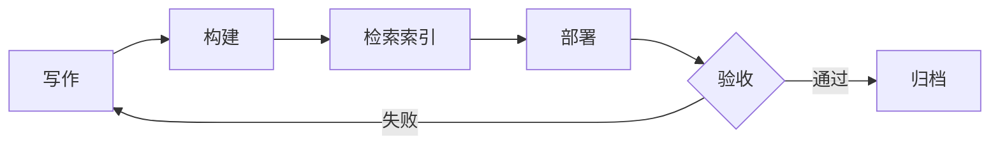

这是一份排版验收样本，用来检查主题是否把每种正文元素都覆盖到了。

## 文本与强调

普通段落、**加粗**、*斜体*、~~删除线~~、`行内代码`、[链接](https://astro.build) 与 <kbd>Ctrl</kbd> + <kbd>K</kbd> 键帽。

> 引用块用于记录结论。左侧 2px 黄铜线，背景是极浅的墨色。

## 列表

1. 有序列表第一项
2. 第二项，含嵌套：
   - 无序子项
   - 另一个子项
3. 第三项

- [x] 已完成的任务
- [ ] 未完成的任务

## 代码块

```ts
type ArchiveEntry = {
  id: `X-${string}`
  title: string
  clearance: 'OPEN' | 'RESTRICTED'
}

export function index(entries: ArchiveEntry[]): Map<string, ArchiveEntry> {
  return new Map(entries.map((entry) => [entry.id, entry]))
}
```

## 数学

行内公式 $E = mc^2$，以及块级公式：

$$
\mathcal{L}(\theta) = -\frac{1}{N}\sum_{i=1}^{N} \log p_\theta(y_i \mid x_i)
$$

## 表格

| 档案编号 | 标题 | 状态 |
| --- | --- | --- |
| X-001 | 建站日志 | OPEN |
| X-002 | 观测日志 | OPEN |
| X-003 | 实验复现 | RESTRICTED |

## 图表



## 分隔与结语

---

元素的视觉优先级应该是：正文 > 代码 > 元数据 > 装饰。任何装饰如果比正文更抢眼，就应该删掉。
